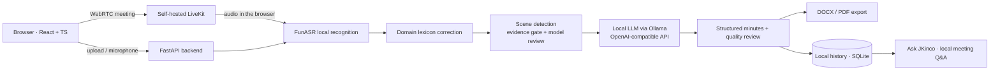

<div align="center">

<a href="https://jkincolisten.cloud">
  
</a>

# MeetDo

**Open-source Meeting-to-Action AI, by 筑听 · JKinco Listen.**
**The meeting ends. AI keeps the work moving.**

MeetDo is the open-source edition of 筑听 · JKinco Listen. Start a browser meeting with
self-hosted media, watch captions stream from a local ASR model, and finish with structured
minutes plus **DOCX/PDF**. No cloud model calls. Your meeting audio stays on infrastructure you
control. The product direction extends that context into a Personal Agent and connected office
workflows, with a completed WorkBuddy connection.

**The finished product is live:** [Open 筑听](https://jkincolisten.cloud) ·
[Product tour, iOS / Android / HarmonyOS downloads](https://jkincolisten.cloud/download/ios)
· [筑听 Z1 recorder](https://jkincolisten.cloud/download/ios)

[简体中文](README.zh-CN.md) · [Docs site](https://wenxuanzhang1209-cyber.github.io/meetdo/en.html) · [Architecture](docs/ARCHITECTURE.en.md) · [Model guide](docs/LOCAL_MODELS.en.md) · [Roadmap](docs/ROADMAP.en.md) · [Changelog](CHANGELOG.md)

[](https://github.com/wenxuanzhang1209-cyber/meetdo/actions/workflows/ci.yml)
[](https://jkincolisten.cloud/download/ios)
[](https://jkincolisten.cloud/download/ios)
[](https://open.workbuddy.cn)


[](CONTRIBUTING.md)

</div>

---

## The finished product is live

The public **筑听 App** turns the same conversation-to-document workflow into a ready-to-use
mobile product: one-tap recording, live transcript while the room is speaking, automatic
structured minutes, Word/PDF export, and **Sona 妙思** meeting Q&A. The WorkBuddy connection is
already complete, extending authorized meeting context into connected office workflows.

[**Open the production app**](https://jkincolisten.cloud) ·
[**Product tour & three-platform downloads**](https://jkincolisten.cloud/download/ios)

[iOS](https://jkincolisten.cloud/download/ios) ·
[Android](https://jkincolisten.cloud/download/android) ·
[HarmonyOS](https://jkincolisten.cloud/download/harmony/app.hap)


<sub>Captured from the public download page: **live capture → filed minutes → grounded meeting
Q&amp;A**. The product tour is Chinese-first; this repository and its contributor documentation
are English-first. [Static poster](docs/production-download-tour.png) ·
[Full-screen overview](docs/production-app-demo.gif) ·
[Capture clip](docs/production-recording.gif) · [Minutes clip](docs/production-generation.gif) ·
[Sona clip](docs/production-sona.gif)</sub>

Built for management reviews, customer calls, project weeklies, interviews, training,
research, and regulated meetings. Construction is the stress test — multiple accountable
parties, dense vocabulary, formal deliverables, and consequences when a responsibility is
transcribed incorrectly.

### Beyond meeting notes

The product category is broader than transcription: a meeting becomes structured, permissioned
context that can continue into post-meeting work.

| Layer | Status | Capability |
|---|---|---|
| Meeting intelligence | **Live** | Capture, live transcript, structured minutes, decisions, owners, DOCX/PDF |
| Sona Q&A | **Live** | Meeting-grounded questions, context, and follow-up support |
| WorkBuddy connection | **Live** | Authorized meeting context can connect to WorkBuddy workflows |
| Personal Agent action orchestration | **Direction** | Approved task breakdown, document drafting, reminders, and status tracking |
| MCP/API interoperability | **Next layer** | Additional connector surfaces, announced only when live |

### A voice-first capture card: 筑听 Z1

JKinco Listen is not limited to a phone microphone. The public product tour includes **筑听 Z1**,
a roughly 44 g magnetic recorder card with dual omnidirectional microphones, a bone-conduction
microphone, 8 / 16 / 32 / 64 GB storage, iOS / Android support, and recognition across more
than 120 languages and dialects. In the production app it appears as a first-class recording
source alongside the phone.

<a href="https://jkincolisten.cloud/download/ios">
  
</a>

<sub>Source: the official Z1 product card. Product availability, configuration, and current
pricing remain governed by the official product page.</sub>

### Production App or Open Edition?

| | Production App | MeetDo Open Edition |
|---|---|---|
| Best for | Using the polished product now | Self-hosting, extending, and auditing the stack |
| Entry point | iOS, Android, HarmonyOS, 筑听 Z1 | Browser + Docker Compose |
| Core flow | One-tap recording, auto minutes, Sona Q&A | Self-hosted LiveKit room, local live captions, local LLM, DOCX/PDF |
| Data boundary | Governed by the production service and its terms | Runs on infrastructure you control |
| Customization | Product experience and templates | Source, models, vocabularies, templates, and deployment |

Both paths start from the same product principle: **the record should be useful while the
meeting is still happening, and filed by the time everyone leaves.**

## Why this exists

Most meeting tools stop at a transcript, or send the room to somebody else's infrastructure.
Neither is enough when the transcript needs to become an accountable document and the audio
cannot leave the building.

MeetDo is for the whole path from conversation to filing:

- **Live meeting** — browser video, screen sharing, chat, and local streaming captions.
- **Local speech recognition** — meeting-grade Mandarin ASR with voice-activity detection,
  punctuation restoration, and domain-term correction.
- **Local LLM** — scene detection, minutes generation, quality review, and meeting Q&A run
  against a model you host (Ollama, or any OpenAI-compatible endpoint).
- **Documents people can file** — five meeting types and custom templates exported to
  DOCX/PDF with the original layout preserved.
- **Local history** — meetings, transcripts, minutes, and human edits stay in a SQLite file
  you own.

> One command to deploy. Join a meeting, speak, and leave with a document.

## Built for any high-context meeting

The product is intentionally general: the same workspace handles a management review, a
customer call, a project weekly, an interview, a training session, or a research interview.
Industry vocabulary and templates are extensions, not the front door.

| Meeting | What MeetDo adds |
|---|---|
| Management / board review | Decisions, owners, risks, and follow-ups in one structured record |
| Project weekly / operations | Live captions, searchable history, and repeatable action-item extraction |
| Customer call / discovery | Needs, objections, commitments, and next steps without uploading the call |
| Interview / hiring panel | A consistent evidence-oriented record and exportable interview minutes |
| Training / workshop | Searchable notes and a durable summary for people who could not attend |
| Research / field interview | Local storage, editable transcript, and portable DOCX/PDF output |

### Construction is our stress test, not our ceiling

A construction site review has multiple accountable parties, dense domain terms, formal
deliverables, and legal consequences if a responsibility is transcribed incorrectly. We use
that environment to harden the generic pipeline: the domain lexicon, evidence gate, and
original-layout export all started there.

The result is stronger for every meeting: evidence-gated scene detection, exact templates,
and a local model stack you can replace.

## How it compares

|  | MeetDo (Open) | Cloud note-takers | Raw Whisper / FunASR |
|---|---|---|---|
| Audio leaves your machine | **Never** | Yes | Never |
| Cloud AI API key / subscription | **None** | Required | None |
| Works fully offline | **Yes**, after first model download | No | Yes |
| Live meeting + local captions | **Yes, self-hosted** | Yes, through their cloud | Captions only |
| Output | **Formatted DOCX/PDF minutes** | Transcript + summary | Raw transcript |
| Domain accuracy | **Hotword lexicon + post-correction** | Generic | Generic |
| Meeting-type awareness | **5 scenes, evidence-gated** | One format | None |
| Self-hosted, MIT licensed | **Yes** | No | Library only |

If you only need a transcript, use Whisper directly — it is simpler. This project exists for
the part *after* the transcript: turning it into a document somebody can actually file.

### Measured domain accuracy

Full results and methodology: **[docs/BENCHMARK.md](docs/BENCHMARK.md)**

Ten noisy Chinese meeting clips, 36 domain terms that a general model tends to get wrong
(construction, HR, and commercial vocabulary), run through the local `paraformer-zh`:

| | Terms recognised |
|---|---|
| Local ASR alone | 31 / 36 |
| **+ domain correction** | **36 / 36** |

Every one of the five failures was a construction term:

```
航站记录 ← 旁站记录      微大工程 ← 危大工程
石滩落度 ← 时坍落度      同条件是块 ← 同条件试块
```

The correction table is built from **what the model actually gets wrong**, not from what a
human might mistype — the first thirteen entries were written by imagining plausible errors,
and when this benchmark ran, not one of them fired. Reproduce it yourself — one command, no arguments:

```bash
pip install funasr torch torchaudio numpy
python3 scripts/benchmark_domain_accuracy.py
```

It synthesises the clips, degrades them with noise and tempo shift, runs the local model, and
prints the same table. The audio is synthetic and therefore **cleaner than a real meeting room**
— treat the number as an upper bound. Its value is comparability: change the model or the
lexicon, run it again, and the delta is trustworthy.

<sub>十段加噪中文会议音频、36 个通用模型容易听错的领域词，过本地 paraformer-zh：
仅本地识别 31/36，加上领域纠错 36/36。五处失误全在工程术语上。
纠错表是照着**模型真正会犯的错**写的——最初那 13 条是想象出来的，跑基准时一条都没命中。</sub>

## Highlights

| | |
|---|---|
| **Live meeting, local captions** | Self-hosted LiveKit rooms, screen sharing, chat, and local streaming ASR in one workspace |
| **Two local model stacks** | FunASR `paraformer-zh` for speech + any Ollama / OpenAI-compatible model for text |
| **Evidence-gated scene detection** | Rule-based gate first, model second — the model cannot force a construction template onto a meeting that lacks the evidence |
| **Original-layout export** | DOCX/PDF that match the real corporate templates, not a generic markdown dump |
| **Privacy by construction** | No cloud AI keys, no telemetry, no outbound model calls; CI scans the working tree and Git history |
| **One-command deploy** | `docker compose up` brings up web, backend, local ASR, Ollama, and a self-hosted LiveKit room |
| **977 automated tests** | Plus security headers, rate limiting, injection defenses, and an audit log |
| **Local knowledge base** | Search past meetings and ask questions across them, without anything leaving the machine |

## Open Edition screenshots


<sub>Full-resolution MP4: <a href="docs/demo.mp4">docs/demo.mp4</a></sub>

**This is what comes out** — summary, agenda flow, conclusions, and action items, with the
full recording-to-export pipeline on the right:


<details>
<summary>More screens (click to expand)</summary>

**Sign-in** — a local account, no cloud registration


**Workspace** — upload, live recording, or read straight from a recorder; seven scene tabs


**History** — per-scene stats, full-text search, reopen and export any past meeting


</details>

## Quick start (Docker)

Requires Docker. 16 GB RAM recommended; 8 GB works but is slower.

```bash
git clone https://github.com/wenxuanzhang1209-cyber/meetdo.git
cd meetdo
cp .env.example .env
docker compose up -d --build
```

Open <http://localhost:8080>.

**First live meeting:** sign in → **实时会议** / Live meetings → **开始会议** → allow the
browser microphone and camera. The first caption downloads the local streaming ASR model;
after that, recognition runs on the same machine.

> **Local trial credentials are deliberately obvious.** `.env.example` ships with the web
> login `admin:123456` and LiveKit development mode (`devkey` / `secret`). The web app listens
> on `0.0.0.0`, while LiveKit's ports bind to loopback by default. Replace both credentials,
> set a reachable `LIVEKIT_PUBLIC_URL`, and terminate TLS before exposing meetings to a network.

The first start automatically:

1. downloads the local ASR model (~1–2 GB; fully offline afterwards);
2. pulls the local LLM `qwen2.5:7b-instruct` via Ollama;
3. builds the web UI and starts the backend.

Want a different model? `OLLAMA_MODEL=qwen2.5:14b docker compose up -d` — nothing else changes.

**NVIDIA GPU:**

```bash
docker compose -f docker-compose.yml -f docker-compose.gpu.yml up -d
```

Apple Silicon needs no configuration; Ollama uses Metal automatically.

**Try it before downloading any model:**

```bash
docker compose -f docker-compose.yml -f docker-compose.demo.yml up -d
```

Demo mode seeds two example minutes so the UI, exports, and history search are all usable
without a model.

## Manual setup

One command, for people who would rather not use Docker:

```bash
bash scripts/install.sh        # Ollama model + Python deps + frontend
bash scripts/start.sh
```

Or step by step:

```bash
# 1. Local LLM (pick one)
brew install ollama && ollama pull qwen2.5:7b-instruct   # macOS
curl -fsSL https://ollama.com/install.sh | sh             # Linux

# 2. Backend
python3 -m venv .venv && source .venv/bin/activate
pip install -r requirements.txt
cp .env.example .env

# 3. Frontend
cd frontend && npm ci && npm run build && cd ..

# 4. Run
uvicorn backend.main:app --host 0.0.0.0 --port 8080
```

Larger model: `OLLAMA_MODEL=qwen2.5:14b bash scripts/install.sh`

The script starts the application and local ASR. For browser meetings, run LiveKit separately
or use the Docker path above, which starts it automatically.

## Model guide

| Stage | Default | Alternatives | Notes |
|---|---|---|---|
| Speech recognition | FunASR `paraformer-zh` | `fsmn-vad` + `ct-punc` | Best value for Chinese meetings; runs on CPU |
| Live captions | FunASR `paraformer-zh-streaming` | Replace the adapter with another streaming ASR | Runs locally; extra model download on first use |
| Scene review | Ollama `qwen2.5:7b-instruct` | `qwen2.5:14b`, `qwen3:8b` | The evidence gate has the final say, so a wrong model answer cannot flip the result |
| Minutes generation | Ollama `qwen2.5:7b-instruct` | Larger models | Chunk → extract in parallel → merge → quality review |
| Meeting Q&A | Same | Same | Local retrieval and generation; history stays on the machine |

Hardware and quantization guidance: [docs/LOCAL_MODELS.en.md](docs/LOCAL_MODELS.en.md).

English-first documentation and contributor workflow are part of the open repository. The
default speech models are Mandarin-first; the architecture is model-agnostic, and additional
language adapters remain an explicit roadmap item rather than an accuracy claim.

## Architecture



Module boundaries, data flow, and the security perimeter: [docs/ARCHITECTURE.en.md](docs/ARCHITECTURE.en.md).

## Core capabilities

### Real-time meetings

- Self-hosted LiveKit for audio, video, screen sharing, and meeting chat.
- Local streaming captions with reconnect handling for long meetings.
- Meeting controls enforced by server-side grants, not hidden buttons.
- End the room, and the final transcript feeds the same local minutes pipeline.

### Evidence-gated scene detection

Five meeting types are distinguished by the roles, business actions, and deliverables that
appear in the transcript:

- **Construction site review** — multiple accountable parties (contractor, supervisor,
  owner) plus a production-control agenda plus periodic review. The formal template is used
  only when that evidence chain is present.
- **General minutes** — management reports, business reviews, project weeklies. No fixed
  template; the model organizes the clearest structure for the source material.
- **Personal assistant** — personal notes, retrospectives, follow-ups.
- **Interview record** — candidate evaluation, competency assessment, hiring recommendation.
- **Customer visit** — customer needs, discussion points, ownership.

The rule-based gate runs first, and it wins: **the model cannot classify a meeting as a
construction review on the strength of generic words like "project", "schedule", "quality".**

### Long recordings

- Duration gate with decompression-bomb protection, measured by decoded duration rather than
  file size.
- Long transcripts are chunked and extracted in parallel; gaps are recorded rather than
  silently discarding the whole run.
- Job queue with per-user quotas and retries. A dropped connection does not lose work already
  transcribed.

### Export and delivery

- Six templates: construction, general, personal, interview, customer visit, and custom
  uploads.
- DOCX and PDF export preserving the original layout, with collision-proof filenames.
- Optional DingTalk bot delivery with request signing. Disabled unless configured.

## Privacy and security

- No cloud model calls, no API keys, no telemetry.
- Audio, transcripts, minutes, and human edits are stored only on the local machine.
- Login rate limiting, CAPTCHA, signed sessions, CSP and security headers, audit log.
- Template upload hardening: zip bombs, path traversal, and XML entity attacks.
- CI enforces the open-edition boundary and scans the full Git history with redacted output;
  the build fails if cloud-model references or credentials appear in either place.

## Testing

```bash
python -m pytest tests-v2                    # 977 tests
python scripts/smoke_test.py                 # offline smoke: scene routing + every export
python scripts/check_open_source_hygiene.py  # open-edition boundary scan
```

GitHub Actions runs the boundary scan, the backend tests, and the frontend build on every
push.

## FAQ

**Do I need a GPU?**
No. The FunASR Chinese model and a quantized 7B model run on a 16 GB CPU machine — just
slower. An NVIDIA or Apple Silicon GPU speeds things up noticeably.

**What if the model download fails?**
Only the first download needs network access; everything afterwards is offline. Point
`JKINCO_ASR_MODEL_DIR` at an existing model directory to skip the download entirely.

**Can I look around before downloading models?**
Set `JKINCO_DEMO_DATA=1` and start. Two example minutes (a construction review and a customer
visit) appear in history, and export, search, and templates all work without any model.

**Is there live captioning?**
Yes. `docker compose up` starts a self-hosted LiveKit server and enables local streaming
captions by default. The first use downloads `paraformer-zh-streaming`; no meeting audio is
sent to a cloud ASR provider. Set `JKINCO_REALTIME_LOCAL_ASR=0` to disable it.

**Can I use it commercially?**
Yes, under the MIT License. Please keep the copyright notice.

**Does it work with languages other than Chinese?**
The repository, documentation, and contributor workflow are English-first. The default ASR
model and domain lexicon are tuned for Mandarin meetings. The architecture is model-agnostic,
so an English or multilingual ASR adapter can be contributed and benchmarked; built-in
multilingual accuracy is not claimed until it is measured.

## Roadmap

- [x] Upload → local transcription → scene detection → minutes → export
- [x] Self-hosted real-time meeting, live local captions, screen sharing, and chat
- [x] History knowledge base and local meeting Q&A
- [ ] Speaker diarization and role attribution
- [ ] WebDAV / cloud-drive backup
- [ ] Desktop installers (macOS / Windows)
- [ ] Additional speech-model adapters (Cantonese / multilingual English / Japanese)

Full plan: [docs/ROADMAP.en.md](docs/ROADMAP.en.md).

## Contributing

Issues, pull requests, and localization help are all welcome. Please read
[CONTRIBUTING.md](CONTRIBUTING.md) first, and run the boundary scan and the test suite before
submitting.

[SUPPORT.md](SUPPORT.md) states what the maintainer commits to — first response within five
working days, security acknowledgement within 72 hours, pull requests reviewed within seven —
and, just as importantly, what is out of scope.

## License

[MIT](LICENSE) © 2026 JKinco

---

---

<sub>
<b>JKinco</b> — local-first tools for work whose data cannot leave the building ·
<a href="https://github.com/wenxuanzhang1209-cyber/meetdo">MeetDo</a> ·
<a href="https://github.com/wenxuanzhang1209-cyber/jkinco-slides">Slides</a> ·
<a href="https://github.com/wenxuanzhang1209-cyber/JKinco-Skills-Lab">Skills Lab</a> ·
<a href="https://github.com/wenxuanzhang1209-cyber/personal-life-hub">Life Hub</a> ·
<a href="https://github.com/wenxuanzhang1209-cyber/jkinco-tools">Tools</a>
</sub>

## Support this project

If MeetDo saved you from typing up one more set of meeting minutes, please **Star** it ⭐.

[](https://star-history.com/#wenxuanzhang1209-cyber/meetdo&Date)
