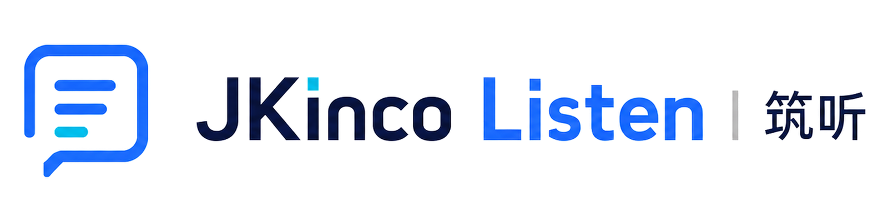
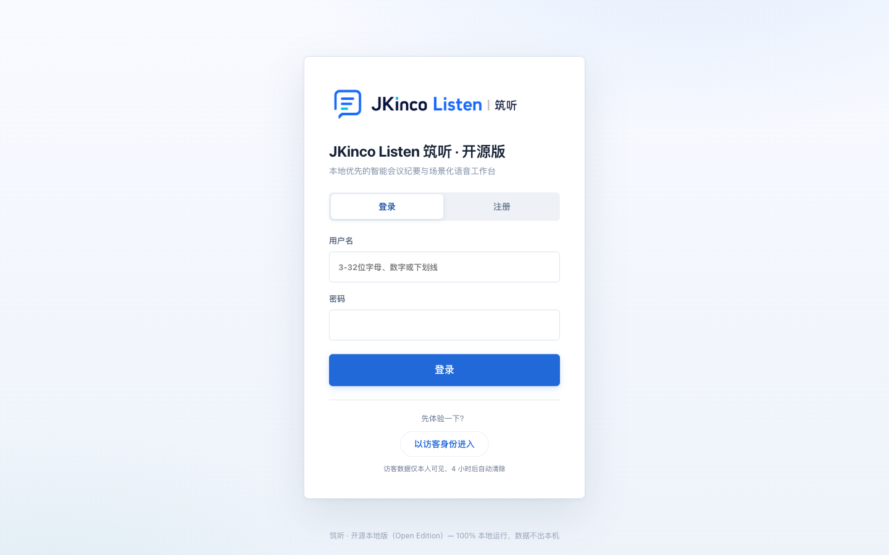
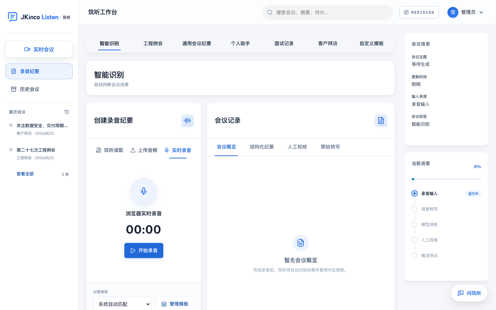
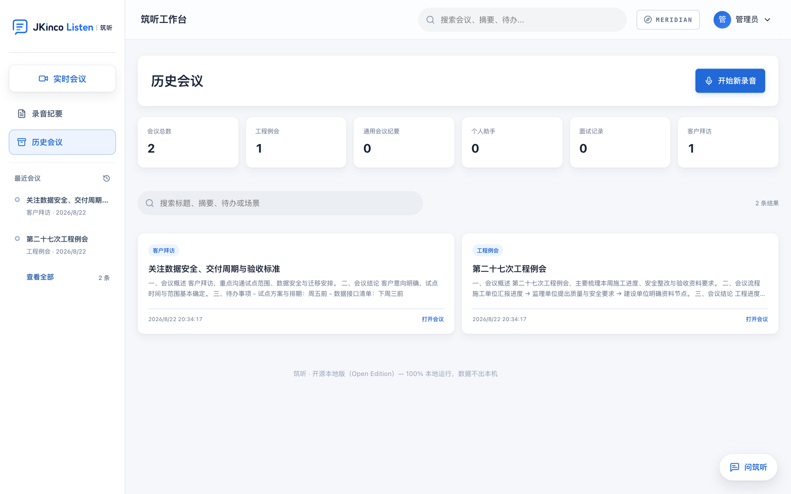
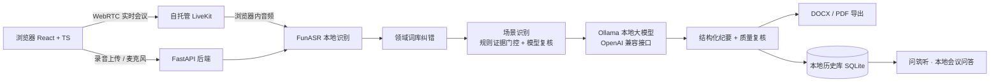

<div align="center">

<a href="https://jkincolisten.cloud">
  
</a>

# MeetDo

**筑听开源版 · Open-source Meeting-to-Action AI**
**会议驱动的 AI 工作执行平台。会议结束，AI 继续把事办完。**

MeetDo 是筑听的开源社区版。用自托管会议房间开视频会、共享屏幕、实时生成本地字幕，
再把整场会议变成结构化纪要和 **DOCX/PDF**。不调用云端模型，会议音频留在你控制的基础
设施里。产品进一步通过 Personal Agent 与办公生态承接会后工作，WorkBuddy 连接已经完成。

**正式产品已上线：** [打开筑听](https://jkincolisten.cloud) ·
[产品演示、三端下载与筑听 Z1](https://jkincolisten.cloud/download/ios)

[English](README.md) · [文档站](https://wenxuanzhang1209-cyber.github.io/meetdo/) · [架构](docs/ARCHITECTURE.md) · [模型指南](docs/LOCAL_MODELS.md) · [路线图](docs/ROADMAP.md) · [更新日志](CHANGELOG.md) · [支持](SUPPORT.md)

[](https://github.com/wenxuanzhang1209-cyber/meetdo/actions/workflows/ci.yml)
[](https://jkincolisten.cloud/download/ios)
[](https://jkincolisten.cloud/download/ios)
[](https://open.workbuddy.cn)


[](CONTRIBUTING.md)

</div>

---

## 正式产品已经上线

公开的 **筑听 App** 把同一套“会议现场 → 可归档文档”的产品链路做成了可直接使用的移动端：
一键录音、边说边出转写、会后自动生成结构化纪要、导出 Word/PDF，并可通过
**Sona 妙思**基于纪要与原文继续追问。WorkBuddy 连接已经完成，可把授权会议上下文带入
已连接的工作流。

[**打开正式版筑听**](https://jkincolisten.cloud) ·
[**产品演示与三端下载**](https://jkincolisten.cloud/download/ios)

[iOS](https://jkincolisten.cloud/download/ios) ·
[安卓](https://jkincolisten.cloud/download/android) ·
[鸿蒙](https://jkincolisten.cloud/download/harmony/app.hap)


<sub>动图录制自公开下载页：**现场采集 → 纪要成稿 → 基于会议追问**。公开产品介绍目前以
中文为主；本开源仓库与贡献文档采用英文优先。[静态海报](docs/production-download-tour.png) ·
[全流程总览](docs/production-app-demo.gif) · [现场采集](docs/production-recording.gif) ·
[自动成稿](docs/production-generation.gif) · [妙思问答](docs/production-sona.gif)</sub>

它面向管理层会议、客户沟通、项目周会、面试、培训、研究访谈和合规要求高的会议。
建筑领域则是最严苛的压力测试：多责任主体、密集术语、正式交付物，以及转错一个责任主体
就可能改变文件含义的真实后果。

### 不止会议纪要

产品品类不只是转写：一场会议会变成经过授权、结构化的上下文，并继续承接会后工作。

| 层级 | 状态 | 能力 |
|---|---|---|
| 会议智能 | **已上线** | 采集、实时转写、结构化纪要、决策与责任人、DOCX/PDF |
| Sona 问答 | **已上线** | 基于会议上下文追问、补齐信息并支持后续事项 |
| WorkBuddy 连接 | **已上线** | 授权会议上下文可进入 WorkBuddy 工作流 |
| Personal Agent 任务编排 | **产品方向** | 经授权拆解任务、起草文档、提醒跟进与更新状态 |
| MCP/API 互操作 | **下一层** | 更多连接能力，只在真实上线后公布 |

### 随身录音卡：筑听 Z1

筑听不只是一款手机 App。公开产品页已经支持 **筑听 Z1**：约 44 g、磁吸随身，
双全向麦克风加 1 个骨传导麦克风，提供 8 / 16 / 32 / 64 GB 存储，支持 Android / iOS，
并可识别 120+ 种语言和方言。在正式 App 中，Z1 与手机录音并列，作为一等的采集入口。

<a href="https://jkincolisten.cloud/download/ios">
  
</a>

<sub>素材来自官方 Z1 产品卡。具体在售状态、配置与价格以正式产品页为准。</sub>

### 正式 App 和开源版怎么选？

| | 正式 App | MeetDo 开源版 |
|---|---|---|
| 适合谁 | 想立即使用成熟产品的人 | 需要自托管、扩展和审计技术栈的人 |
| 使用入口 | iOS、Android、鸿蒙、筑听 Z1 | 浏览器 + Docker Compose |
| 核心流程 | 一键录音、自动成稿、Sona 会议问答 | 自托管 LiveKit、本地实时字幕、本地大模型、DOCX/PDF |
| 数据边界 | 以正式产品服务及其条款为准 | 运行在你控制的基础设施上 |
| 可定制项 | 产品体验与模板 | 源码、模型、词库、模板和部署方式 |

两条路径共享同一个产品原则：**会议还在进行时，记录就要有用；人离开会议室时，纪要
就应该已经能归档。**

## 为什么会有这个项目

大多数会议工具只交出一段转写，或者要求把整场会议交给第三方基础设施。可真正重要的是
一份能追责、能归档的文档；如果录音本身不能离开现场，方案就更少了。

MeetDo 覆盖从会议现场到文件归档的完整路径：

- **实时会议**：浏览器视频、屏幕共享、会议聊天、本机流式字幕；
- **本地语音识别**：中文会议级 ASR（VAD 静音检测 + 标点恢复 + 领域纠错）；
- **本地大模型**：场景识别、纪要生成、质量复核、会议问答全部走本地模型；
- **可归档产出**：五类会议场景和自定义模板，DOCX/PDF 原版式导出；
- **本地历史库**：会议、转写、纪要、校核稿全部存在本机，随时检索与导出。

> 一条命令部署。开会、说话、离开时带走一份文档。

## 为所有高信息密度的会议设计

MeetDo 不是只服务某一个行业。管理层会议、客户沟通、项目周会、面试、培训、研究访谈，
都使用同一个工作台；行业词库和专属模板是扩展能力，不是使用门槛。

| 会议场景 | 筑听带来的价值 |
|---|---|
| 管理层 / 董事会 | 结论、责任人、风险与后续动作进入同一份结构化记录 |
| 项目周会 / 运营会 | 实时字幕、可检索历史、稳定的待办提取 |
| 客户沟通 / 需求访谈 | 需求、异议、承诺与下一步留在本地，不上传录音 |
| 面试 / 评审会 | 一致、可追溯的面试记录，直接导出纪要 |
| 培训 / 工作坊 | 可检索笔记，让没参会的人也能快速补上下文 |
| 研究 / 田野访谈 | 本地存储、可编辑转写、便携 DOCX/PDF 产出 |

### 建筑领域是最严苛的压力测试

工程例会涉及多责任主体、密集术语、正式交付物；一个责任主体写错，就可能改变文件的
法律含义。我们从这个最难的环境开始打磨通用流水线：领域词库、证据门控、原版式导出，
都先在这里经受检验。

最终受益的是所有会议：更可靠的场景判断、可替换的本地模型栈，以及真正能归档的文档。

## 📊 和别的方案比

|  | 筑听开源版 | 云端会议助手 | 直接用 Whisper / FunASR |
|---|---|---|---|
| 音频是否出本机 | **从不** | 是 | 从不 |
| 需要云端 AI Key / 订阅 | **不需要** | 需要 | 不需要 |
| 完全离线可用 | **可以**（首次下载模型后） | 不行 | 可以 |
| 实时会议 + 本地字幕 | **支持，自托管** | 支持，但经过厂商云端 | 仅字幕 |
| 产出物 | **排好版的 DOCX/PDF 纪要** | 转写 + 摘要 | 纯转写 |
| 领域词准确率 | **热词词库 + 识别后纠错** | 通用 | 通用 |
| 会议类型区分 | **五类场景，证据门控** | 单一格式 | 无 |
| 自托管 · MIT | **是** | 否 | 仅库 |

只要转写的话，直接用 Whisper 更简单。这个项目要解决的是**转写之后**那一段：
把它变成一份能归档、能发出去的文档。

### 可复现的领域词实测

完整结果与方法说明：**[docs/BENCHMARK.md](docs/BENCHMARK.md)**

十段加噪的中文会议音频、36 个通用模型容易听错的领域词（工程、人事、商务），
过本地 `paraformer-zh`：

| | 领域词命中 |
|---|---|
| 仅本地识别 | 31 / 36 |
| **加上领域纠错** | **36 / 36** |

五处失误全部落在工程术语上：

```
航站记录 ← 旁站记录      微大工程 ← 危大工程
石滩落度 ← 时坍落度      同条件是块 ← 同条件试块
```

纠错表是照着**模型真正会犯的错**写的，不是照着"人可能怎么打错"写的——
最初那 13 条是想象出来的，跑这个基准时一条都没命中。
自己跑一遍 —— 一条命令，无参数：

```bash
pip install funasr torch torchaudio numpy
python3 scripts/benchmark_domain_accuracy.py
```

它会合成音频、加噪提速、过本地模型，打印出同一张表。音频是合成的，**比真实会议室干净**，
所以这个数字是上界而不是现场分数。它的价值在于可比较：换模型或改词库之后再跑一遍，差值是可信的。

## ✨ 亮点

| | 能力 |
|---|---|
| 🎥 **实时会议 + 本机字幕** | 自托管 LiveKit、屏幕共享、聊天与本地流式 ASR 在同一个工作台 |
| 🧠 **双本地模型栈** | FunASR `paraformer-zh` 中文识别 + Ollama 任意 OpenAI 兼容本地模型 |
| 🏗️ **工程场景识别** | 规则证据门控 + 模型复核，拒绝“看着像工程会就套工程模板” |
| 📄 **原版式导出** | 工程例会、面试记录、客户拜访等 DOCX/PDF，保留真实模板排版 |
| 🔐 **隐私第一** | 无云端 AI Key、无云端调用、无遥测；模型下载完成后完全离线可用 |
| 🚀 **一键部署** | `docker compose up` 全家桶：Web + 后端 + 本地 ASR + Ollama + 自托管 LiveKit |
| 🧪 **工程级质量** | 977 个自动化测试、安全头、限流、防注入、审计日志全覆盖 |
| 🗃️ **历史知识库** | 会议历史检索 + “问筑听”本地问答，跨会议追待办不丢上下文 |

## 🖥️ 开源版界面预览


<sub>完整演示（有声版 MP4）：<a href="docs/demo.mp4">docs/demo.mp4</a></sub>

**产出物长这样** —— 会议概述、流程、结论、待办事项，右侧是从录音到导出的完整流水线：


<details>
<summary>更多界面（点开）</summary>

**登录页**：本地账号，没有云端注册



**工作台**：上传录音、实时录音、设备直读三种入口，七类场景标签



**历史会议**：按场景统计，全文检索，随时回看与导出



</details>

## 🚀 快速开始（推荐：Docker）

要求：已安装 Docker，机器建议 16GB 内存（8GB 可用但会更慢）。

```bash
git clone https://github.com/wenxuanzhang1209-cyber/meetdo.git
cd meetdo
cp .env.example .env
docker compose up -d --build
```

打开 <http://localhost:8080>。

**第一次实时会议：** 登录 → **实时会议** → **开始会议** → 允许浏览器使用麦克风和摄像头。
第一条字幕会触发本地流式 ASR 模型下载；之后识别全程在本机运行。

> **本地试用凭据故意写成一眼可见。** `.env.example` 预置网页登录 `admin:123456`，
> LiveKit 使用开发模式 `devkey / secret`。网页监听 `0.0.0.0`，LiveKit 端口默认只绑定
> 本机回环地址。开放给局域网或公网前，必须更换两套凭据、设置可达的
> `LIVEKIT_PUBLIC_URL`，并在前置代理启用 TLS。

首次启动会自动：

1. 下载本地 ASR 模型（约 1–2GB，之后完全离线）；
2. 拉取本地大模型 `qwen2.5:7b-instruct`（Ollama）；
3. 构建 Web 界面并启动后端。

> 想换模型？`OLLAMA_MODEL=qwen2.5:14b docker compose up -d` 即可，其余不变。

> NVIDIA GPU 加速：`docker compose -f docker-compose.yml -f docker-compose.gpu.yml up -d`
> （Apple Silicon 无需配置，Ollama 自动走 Metal。）

> 先看效果再下载模型：`docker compose -f docker-compose.yml -f docker-compose.demo.yml up -d`
> （示例模式会自动写入两条示例纪要，界面、导出、历史检索全部可用。）

## 🛠️ 手动安装

一条命令（推荐给不想用 Docker 的用户）：

```bash
bash scripts/install.sh        # 自动装 Ollama 模型 + Python 依赖 + 前端
bash scripts/start.sh          # 启动
```

或分步执行：

```bash
# 1. 本地大模型（任选其一）
brew install ollama && ollama pull qwen2.5:7b-instruct   # macOS
curl -fsSL https://ollama.com/install.sh | sh             # Linux

# 2. 后端
python3 -m venv .venv && source .venv/bin/activate
pip install -r requirements.txt
cp .env.example .env

# 3. 前端
cd frontend && npm ci && npm run build && cd ..

# 4. 启动
uvicorn backend.main:app --host 0.0.0.0 --port 8080
```

> 换更大模型：`OLLAMA_MODEL=qwen2.5:14b bash scripts/install.sh`

脚本会启动应用与本地 ASR。浏览器实时会议还需要 LiveKit：可以直接使用上面的 Docker
路径，或自行启动 LiveKit 后把 `.env` 里的连接地址指向它。

## 🧠 模型指南

| 环节 | 默认模型 | 备选 | 说明 |
|---|---|---|---|
| 语音识别 | FunASR `paraformer-zh` | `fsmn-vad` + `ct-punc` | 中文会议最优性价比，CPU 可跑 |
| 实时字幕 | FunASR `paraformer-zh-streaming` | 替换为其他流式 ASR 适配器 | 本机运行，首次使用需额外下载 |
| 场景复核 | Ollama `qwen2.5:7b-instruct` | `qwen2.5:14b`、`qwen3:8b` 等 | 证据门控兜底，模型说错也翻不了盘 |
| 纪要生成 | Ollama `qwen2.5:7b-instruct` | 更大模型 | 自动分块 → 并行提取 → 合成 → 质量复核 |
| 会议问答 | 同上 | 同上 | 本地检索 + 生成，历史不出本机 |

详细硬件与量化建议见 [docs/LOCAL_MODELS.md](docs/LOCAL_MODELS.md)。

开源仓库以英文作为默认展示与贡献入口，中文 README 和文档保持同步；这样海外开发者
先看到完整能力边界，再选择自己熟悉的语言参与。默认语音模型仍以中文会议为第一优先，
其他语言通过可替换的 ASR 适配器扩展。

## 🏗️ 架构



模块职责、数据流与安全边界见 [docs/ARCHITECTURE.md](docs/ARCHITECTURE.md)。

## 🗂️ 核心能力

### 实时会议

- 自托管 LiveKit：音视频、屏幕共享、会议聊天；
- 本地流式字幕：长会议自动重连，不依赖云端 ASR；
- 共享屏幕、聊天等权限由服务端令牌强制，不能靠隐藏按钮绕过；
- 会议结束后，最终转写直接进入同一套本地纪要流水线。

### 智能场景识别

根据转写中的角色、业务动作与交付物证据，区分五类场景：

- **工程例会**：施工、监理、建设等多责任主体 + 生产控制议程 + 周期复盘，形成证据链才使用工程模板；
- **通用会议纪要**：管理汇报、经营分析、项目周会等，由模型按原文组织结构；
- **个人助手**：个人备忘、工作复盘、事项跟进；
- **面试记录**：候选人评价、能力评估、录用建议；
- **客户拜访**：客户诉求、沟通要点、责任分工。

规则证据门控优先：**模型不能仅凭“项目、进度、质量”这类泛词把会议套成工程例会**。

### 长录音处理

- 时长闸门 + 解压炸弹防护（按解码时长而非文件大小）；
- 超长转写自动分块，并行提取、缺失留痕、不整段作废；
- 任务队列、按用户配额、失败可重试，断网不丢已转写内容。

### 导出与推送

- 六套模板（工程/通用/个人/面试/客户拜访/自定义）；
- Word、PDF 原版式导出，文件名唯一防覆盖；
- 可选钉钉机器人推送（加签），不配置即关闭。

## 🔐 隐私与安全

- **无云端模型调用、无云端 API Key、无遥测**；
- 音频、转写、纪要、校核稿保存在你运行服务的机器上；
- 登录限流、验证码、会话签名、CSP/安全头、审计日志；
- 模板上传解压防护（Zip 炸弹、路径穿越、XML 实体）；
- 开源版红线：CI 同时扫描工作区与完整 Git 历史，命中只输出脱敏位置；
  禁止云端模型痕迹与真实凭据混入仓库。

## 🧪 测试与质量

```bash
python -m pytest tests-v2             # 977 个测试
python scripts/smoke_test.py          # 离线冒烟：场景路由 + 全场景导出
python scripts/check_open_source_hygiene.py  # 开源版红线扫描
```

CI（GitHub Actions）自动执行：红线扫描 → 后端测试 → 前端构建。

## ❓ FAQ

**必须要 GPU 吗？**
不用。FunASR 中文模型与 7B 量化模型在 16GB 内存的 CPU 上可以跑，只是更慢；
有 NVIDIA/Apple Silicon GPU 会明显加速。

**模型下载失败怎么办？**
首次下载需要网络，之后完全离线。可设置 `JKINCO_ASR_MODEL_DIR` 指定已有模型目录。

**不想先下载模型，怎么快速体验？**
设 `JKINCO_DEMO_DATA=1` 后启动，历史里会自动出现两条示例纪要（工程例会 + 客户拜访），
导出、历史检索、模板都能直接玩，不依赖任何模型。

**支持实时字幕吗？**
支持。`docker compose up` 会启动自托管 LiveKit，并默认开启本地流式字幕。首次使用会
下载 `paraformer-zh-streaming`，会议音频不会发送给云端 ASR。设
`JKINCO_REALTIME_LOCAL_ASR=0` 可关闭。

**可以商用吗？**
可以，MIT License。请保留版权声明。

## 🗺️ 路线图

- [x] 录音上传 → 本地转写 → 场景识别 → 纪要 → 导出全链路
- [x] 自托管实时会议、本地字幕、屏幕共享与聊天
- [x] 历史知识库与本地会议问答
- [ ] 说话人分离 / 角色识别
- [ ] WebDAV / 坚果云自动备份
- [ ] 桌面安装包（macOS / Windows）
- [ ] 更多语音模型适配器（粤语 / 多语种英语 / 日语）

完整计划见 [docs/ROADMAP.md](docs/ROADMAP.md)。

## 🤝 贡献

欢迎 Issue、PR 与本地化贡献。提交前请先阅读 [CONTRIBUTING.md](CONTRIBUTING.md)，
并运行红线扫描与测试。

[SUPPORT.md](SUPPORT.md) 写明了维护者的承诺——Issue 首次回应 5 个工作日、安全报告
72 小时确认、PR 7 个工作日评审——以及同样重要的：哪些事情不在支持范围内。

## 📄 许可证

[MIT](LICENSE) © 2026 JKinco

---

---

<sub>
<b>JKinco</b> — local-first tools for work whose data cannot leave the building ·
<a href="https://github.com/wenxuanzhang1209-cyber/meetdo">MeetDo</a> ·
<a href="https://github.com/wenxuanzhang1209-cyber/jkinco-slides">Slides</a> ·
<a href="https://github.com/wenxuanzhang1209-cyber/JKinco-Skills-Lab">Skills Lab</a> ·
<a href="https://github.com/wenxuanzhang1209-cyber/personal-life-hub">Life Hub</a> ·
<a href="https://github.com/wenxuanzhang1209-cyber/jkinco-tools">Tools</a>
</sub>

## ⭐ 支持这个项目

如果 MeetDo 帮你省下了一次次手动整理会议纪要的时间，请点右上角 **Star** ⭐。

[](https://star-history.com/#wenxuanzhang1209-cyber/meetdo&Date)
