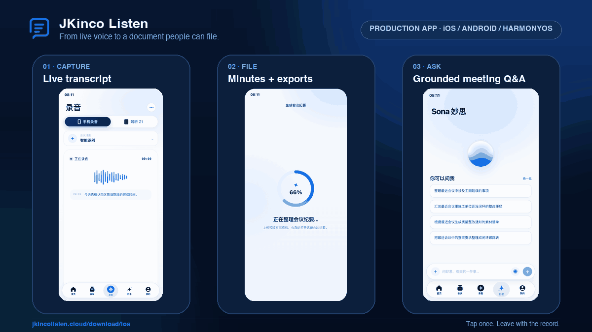
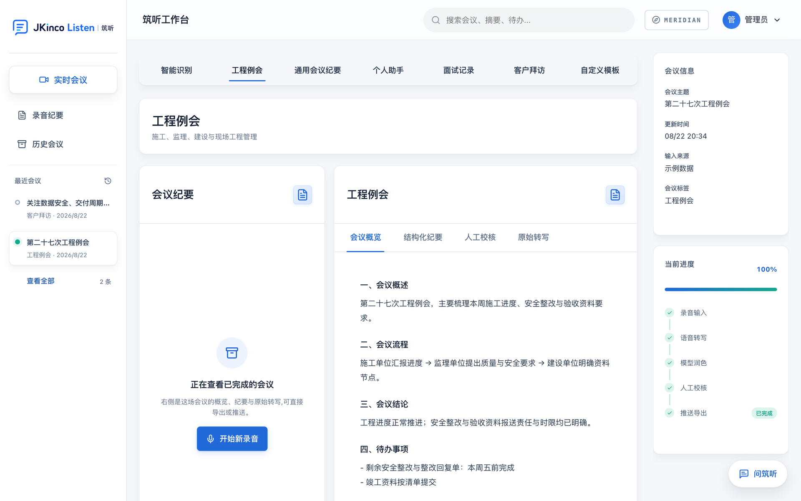

<p align="center">
  <a href="https://jkincolisten.cloud">
    
  </a>
</p>

# JKinco Listen (Open Edition)

*[简体中文](index.md)*

**A private meeting workspace that runs live.** Join a self-hosted browser meeting, watch
local streaming captions, then turn the room into structured minutes and DOCX/PDF. No cloud
model call and no cloud API key.

> **The finished product is live.**<br>
> [Open 筑听](https://jkincolisten.cloud) ·
> [Product tour + iOS / Android / HarmonyOS downloads](https://jkincolisten.cloud/download/ios)



<sub>The public product tour is Chinese-first; this repository and its contributor
documentation are English-first. [Static poster](production-download-tour.png) ·
[Full-screen overview](production-app-demo.gif)</sub>

### Capture hardware: 筑听 Z1

The production product also exposes **筑听 Z1** as a recording source: an approximately 44 g
magnetic capture card with dual omnidirectional microphones, a bone-conduction microphone,
8 / 16 / 32 / 64 GB storage, iOS / Android support, and recognition across more than 120
languages and dialects.

[](https://jkincolisten.cloud/download/ios)

<sub>Product availability, configuration, and pricing remain governed by the official product
page.</sub>

<video src="demo.mp4" controls muted loop playsinline width="100%" poster="demo-minutes.png"
       style="border-radius:12px;box-shadow:0 8px 28px rgba(15,23,42,.18);margin:20px 0">
  Your browser cannot play embedded video — <a href="demo.mp4">download the demo</a>.
</video>

---

## One product, two ways to use it

| | Production App | Open Edition |
|---|---|---|
| Best for | Using the polished product now | Self-hosting, extending, and auditing |
| Platforms | iOS, Android, HarmonyOS | Browser + Docker Compose |
| Workflow | One-tap recording, auto minutes, Sona Q&A | LiveKit rooms, local live captions, local LLM, DOCX/PDF |
| Data boundary | Governed by the production service and its terms | Runs on infrastructure you control |

The public mobile product and this repository share the same product direction: useful live
capture, reliable structured minutes, and a file that is ready when the meeting ends.

## The general problem

Most meeting tools stop at a transcript. Cloud note-takers can produce a reasonable summary,
but they require the conversation to reach their infrastructure. Neither model is enough when
the output has to become an accountable document and the recording cannot leave the building.

JKinco Listen handles management reviews, customer calls, project weeklies, interview panels,
training sessions, research interviews, and regulated meetings in one workspace. The important
part is not one industry: it is the entire path from live conversation to a file someone can
review, search, and archive.

### Engineering is the stress test

A construction site review combines multiple accountable parties, dense terminology, formal
templates, and legal consequences when a responsibility is transcribed incorrectly. We use
that environment to harden the generic pipeline. It proves the evidence gate and original-layout
export under unusually demanding conditions; it does not limit who the product is for.

## What comes out

Summary, agenda flow, conclusions, and action items — with the full recording-to-export
pipeline on the right:



## Measured, not claimed

Ten noisy Chinese meeting clips, 36 terms a general model tends to mishear:

| | Terms recognised |
|---|---|
| Local ASR alone | 31 / 36 |
| **+ domain correction** | **36 / 36** |

Reproduce it in one command — see **[the benchmark page](BENCHMARK.md)** for the method, the
per-clip results, and the three bugs writing that benchmark found in this project's own code.

## Quick start

```bash
git clone https://github.com/wenxuanzhang1209-cyber/jkinco-listen-open.git
cd jkinco-listen-open
cp .env.example .env
docker compose up -d --build
```

Open <http://localhost:8080>.

Start a live meeting from the meeting lobby. The first caption downloads the local streaming
ASR model; after that, captions run on the machine hosting the service.

> ⚠️ **Local trial credentials are deliberately obvious.** The web login is
> `admin:123456`, and LiveKit runs in development mode. Replace both credentials, configure a
> reachable `LIVEKIT_PUBLIC_URL`, and terminate TLS before exposing the service.

Want to see the interface before downloading 2 GB of models? Set `JKINCO_DEMO_DATA=1` and two
example meetings appear, with export, search, and templates all usable.

## How it compares

|  | JKinco Listen | Cloud note-takers | Raw Whisper |
|---|---|---|---|
| Audio leaves your machine | **Never** | Yes | Never |
| API key required | **No** | Yes | No |
| Output | **Formatted DOCX/PDF** | Transcript + summary | Raw transcript |
| Meeting-type awareness | **5 scenes, evidence-gated** | One format | None |

If you only need a transcript, use Whisper directly — it is simpler. This exists for the part
*after* the transcript: turning it into a document somebody can file.

## Under the hood

- 🎙 **Local speech recognition** — FunASR `paraformer-zh`
- 🎥 **Self-hosted live meetings** — LiveKit rooms, screen sharing, chat, and local streaming captions
- 🧠 **Local LLM** — Ollama (`qwen2.5:7b-instruct` by default) or any OpenAI-compatible endpoint
- 🏗 **Evidence-gated scene detection** — rules decide first; the model may downgrade a
  classification but never promote one, because the wrong template produces a document
  asserting the wrong legal responsibility
- 📄 **Original-layout DOCX/PDF export**
- 🔐 **No cloud AI API key, no cloud inference, no telemetry** — checked in CI, not only asserted in a README
- 🐳 **One-command Docker deploy**

English-first documentation and contributor workflow are part of this repository. The default
ASR model is Mandarin-first; multilingual recognition is an adapter and benchmark milestone,
not an accuracy claim.

## Documentation

- [Project home (README)](https://github.com/wenxuanzhang1209-cyber/jkinco-listen-open)
- [Benchmark](BENCHMARK.md)
- [Architecture](ARCHITECTURE.en.md)
- [Model guide](LOCAL_MODELS.en.md)
- [Roadmap](ROADMAP.en.md)
- [About the Open Edition](OPEN_EDITION.en.md)

## Community

- [Discussions](https://github.com/wenxuanzhang1209-cyber/jkinco-listen-open/discussions)
- [Issues](https://github.com/wenxuanzhang1209-cyber/jkinco-listen-open/issues)

If this saved you from typing up one more set of meeting minutes, please ⭐ the repository.

MIT License © 2026 JKinco

---

<sub>
<b>JKinco</b> — local-first tools for work whose data cannot leave the building ·
<a href="https://github.com/wenxuanzhang1209-cyber/jkinco-listen-open">Listen</a> ·
<a href="https://github.com/wenxuanzhang1209-cyber/jkinco-slides">Slides</a> ·
<a href="https://github.com/wenxuanzhang1209-cyber/JKinco-Skills-Lab">Skills Lab</a> ·
<a href="https://github.com/wenxuanzhang1209-cyber/personal-life-hub">Life Hub</a> ·
<a href="https://github.com/wenxuanzhang1209-cyber/jkinco-tools">Tools</a>
</sub>
